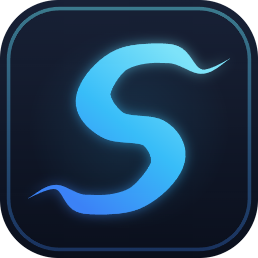
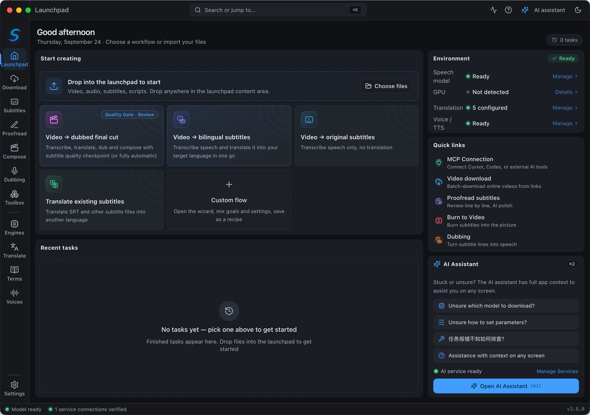
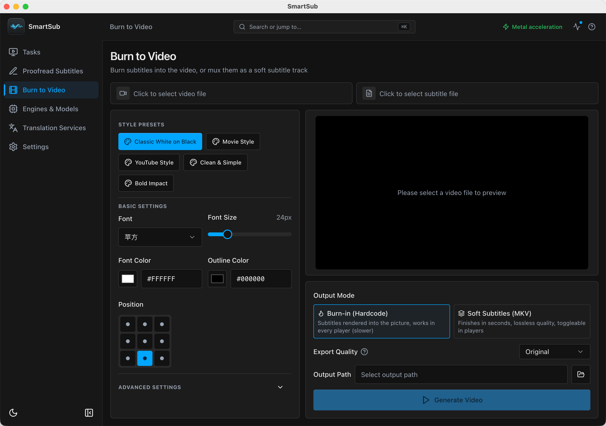
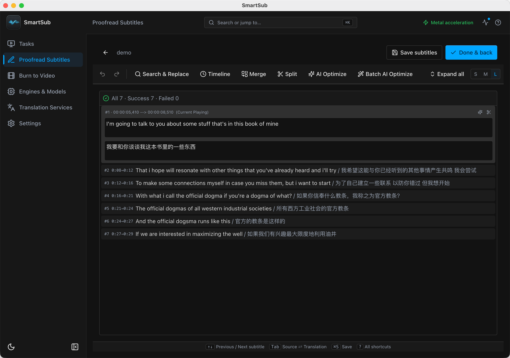
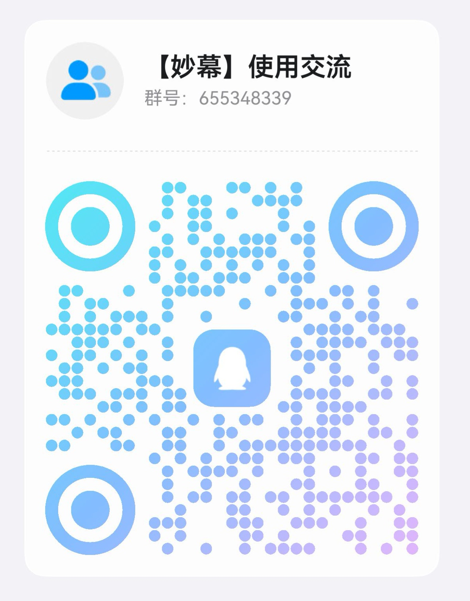

<div align="center">



# SmartSub

**Dahili Yapay Zeka Asistanı ve MCP/CLI otomasyonu ile altyazı oluşturma, çeviri, dublaj ve gömme — hepsi bir arada açık kaynaklı masaüstü uygulaması**

Her kareyi kusursuzca konuşturun

<a href="https://trendshift.io/repositories/14079?utm_source=repository-badge&amp;utm_medium=badge&amp;utm_campaign=badge-repository-14079" target="_blank" rel="noopener noreferrer"></a>
<a href="https://trendshift.io/repositories/14079?utm_source=trendshift-badge&amp;utm_medium=badge&amp;utm_campaign=badge-trendshift-14079" target="_blank" rel="noopener noreferrer"></a>

[](https://github.com/buxuku/SmartSub/releases/latest)
[](https://github.com/buxuku/SmartSub/releases)
[](https://github.com/buxuku/SmartSub/releases)
[](https://github.com/buxuku/SmartSub/blob/master/LICENSE)

[中文](README.md) | [English](README_EN.md) | [日本語](README_JA.md) | [Türkçe](README_TR.md)

[İndir](#indirme-ve-kurulum) · [Özellikler](#özellikler) · [Yapay Zeka Asistanı ve Otomasyon](#-yapay-zeka-üretici-asistanı-uygulama-içi-copilot) · [Ücretsiz İş Akışı](#tamamen-ücretsiz-bir-iş-akışı) · [SSS](#sıkça-sorulan-sorular) · [Sürüm Notları](https://github.com/buxuku/SmartSub/releases)

</div>



## SmartSub Nedir?

SmartSub, tüm iş akışını (**sesi metne dönüştürme (STT) → altyazı çevirisi → redaksiyon/düzeltme → yapay zeka ile dublaj → altyazı gömme**) tek bir masaüstü uygulamasında toplayan, dahili çevrim içi video indiricisine sahip açık kaynaklı bir altyazı ve dublaj aracıdır: Bir YouTube / Bilibili bağlantısı yapıştırın, kaynak video sizin için indirilsin. Deşifre (transkripsiyon) yerel modellerde (whisper.cpp, sherpa-onnx ve daha fazlası) çalışır, böylece dosyalarınız asla cihazınızdan dışarı çıkmaz. Toplu işlemleri destekler, NVIDIA / AMD / Intel / Apple Silicon GPU'ları ile donanım hızlandırmasından yararlanır ve Windows, macOS ve Linux üzerinde sorunsuz çalışır.

SmartSub, modern yapay zeka copilot ve ajan tabanlı (agentic) otomasyon yeteneklerini derinlemesine entegre eder:
- **Uygulama İçi Yapay Zeka Üretici Asistanı (Copilot)**: Derin çalışma alanı bağlam farkındalığı, çok modlu (multimodal) ekran görüntüsü tanılaması, gerçek zamanlı ve geri alınabilir altyazı düzenleme ile doğal dille ajan tabanlı araç çalıştırma yetenekleriyle dilediğiniz an klavye kısayolu ile açılır.
- **MCP Protokolü ve CLI Otomasyonu**: 111 üretim kalitesinde araç ve eşleşen CLI komutları ile tam Model Context Protocol (MCP) desteği. Harici Node.js kurulumu gerektirmeyen gömülü Electron/Node çalışma zamanı ile birlikte gelir; Cursor, Claude Code, OpenAI Codex ve terminal script'leri ile doğrudan bağlantı kurar.

**Tüm iş akışı sıfır maliyetle çalışabilir**: Yerel Whisper transkripsiyonu, dahili ücretsiz çeviri kaynakları, ses klonlama özellikli yerel TTS dublajı ve yerel ffmpeg ile altyazı gömme — API anahtarı gerekmez, yerel işlemlerde kota veya sınır yoktur. İhtiyaç duyduğunuzda 20 çeviri servisini, 9 bulut transkripsiyon sağlayıcısını ve 6 bulut TTS hizmetini entegre edebilirsiniz.

## Sizin için neler yapabilir?

| Amacınız                                      | SmartSub bunu nasıl çözer?                                                                  |
| --------------------------------------------- | ------------------------------------------------------------------------------------------ |
| Altyazıları yapay zeka ile düzeltme ve hata ayıklama | Çalışma alanı bağlamı ve görsel ekran görüntüsü tanılaması ile uygulama içi yapay zeka asistanını çağırın; diyalogları yeniden yazdırın, jargonu açıklatın veya görevleri yönetin |
| Cursor / Claude / CLI ile iş akışlarını otomatikleştirme | Harici yapay zeka ajanlarının veya terminal komut dosyalarının videoları otomatik olarak deşifre etmesini, çevirmesini, seslendirmesini ve altyazı gömmesini sağlamak için 111 MCP aracı ve CLI komutunu kullanın |
| Yabancı videoları veya dersleri altyazısız izleme | Videoyu sürükleyip bırakın, yerel olarak deşifre edin, çevirin — anında çift dilli altyazı elde edin |
| Çevrim içi bir videoya (YouTube / Bilibili) altyazı ekleme | Bağlantıyı yapıştırın — video uygulama içinde indirilir, resmi altyazılar otomatik eşleşir, üçüncü taraf araç gerekmez |
| İçeriği diğer diller ve pazarlar için yerelleştirme | Altyazıları çevirin, ardından TTS ile yeni bir ses parçası olarak dublaj yapın             |
| Videoları kendi sesinizle seslendirme         | Kısa bir ses örneği kaydedin, sesinizi klonlayın ve tüm videoyu kendi sesinizle okutun    |
| Podcast, ders ve toplantı kayıtlarını arşivleme | Düzenleme, arama veya arşivleme için toplu olarak SRT dosyalarına dönüştürün              |
| Videoları kusursuz altyazılarla yayınlama     | Satır satır kontrol edin, ardından WYSIWYG stil önizlemesiyle videoya kalıcı olarak gömün (hardcode) veya esnek parça (soft-mux) olarak ekleyin |

## Özellikler

Çevrim içi video **indirme** / yerel medya → **deşifre (transkripsiyon)** → **çeviri** → **redaksiyon (düzeltme)** → **dublaj** → **dışa aktarma**. Her adımı tek başına kullanabilir veya bunları toplu bir işlem zincirine dönüştürebilirsiniz — **uygulama içi yapay zeka Copilot** desteğiyle veya **MCP / CLI** aracılığıyla otomatikleştirilmiş olarak.

### 🌟 Yapay Zeka Üretici Asistanı (Uygulama İçi Copilot)

- **Anında çağırma ve çok turlu sohbet**: Üst araç çubuğundaki butondan veya `⌘J` (macOS) / `Ctrl+J` (Windows / Linux) kısayolu ile yeniden boyutlandırılabilir asistan çekmecesini dilediğiniz zaman açın. Sohbet geçmişi yerel olarak saklanır.
- **Derin çalışma alanı bağlam farkındalığı**: Mevcut oynatma konumunu, seçili altyazı satırını, çevreleyen satırları, görev kuyruğu durumunu ve son hata günlüklerini otomatik olarak algılar — bağlamı tekrar tekrar kopyalayıp yapıştırmanıza gerek kalmaz.
- **Ajan tabanlı araç çalıştırma**: 111 dahili otomasyon aracıyla doğrudan entegredir! Yalnızca sohbet etmekle kalmaz, sizin adınıza görevleri yürütür: videoları deşifre eder, çevirir, dublaj parçaları sentezler, modelleri sorgular ve hataları giderir.
- **Tahribatsız ve güvenli düzenleme**: Asistandan "bu cümleyi daha konuşma diline uygun yap", "bu terimi açıkla" veya "sesteş sözcük hatalarını düzelt" gibi taleplerde bulunun. Düzenlemeler tam geri alma/yineleme (`Ctrl+Z`) desteği ve belge sürümleme koruması ile anında editöre yansır; yalnızca siz "kaydet" dediğinizde diske yazılır.
- **Çok modlu (multimodal) görsel ekran görüntüsü tanılaması**: Bir görev hatasıyla mı karşılaştınız veya bir ayarı anlayamadınız mı? Asistan çalışma alanının ekran görüntüsünü alabilir (veya kamera butonuna tıklayabilirsiniz) ve görme yetenekli LLM'ler aracılığıyla diyalogları, hata bildirimlerini ve arayüz kontrollerini anında inceler.
- **Medya dosyalarıyla sohbet**: Ses, video, altyazı (SRT/VTT/ASS/LRC), referans metinleri (TXT/MD) veya görselleri sohbete sürükleyip bırakın. Ses/video dosyaları asla buluta yüklenmez — yalnızca yerel mutlak yollar yerel işleme araçlarına iletilir, gizliliğiniz ve performansınız korunur.
- **Esnek LLM desteği**: DeepSeek, Qwen (DashScope), Gemini, SiliconFlow, DeerAPI ve akış (streaming) ile özelleştirilebilir istemleri destekleyen tüm OpenAI uyumlu API uç noktalarını destekler. Bkz: [Yapay Zeka Asistanı Kılavuzu](docs/docs/features/ai-assistant.md).

### ⚡ MCP Protokolü ve CLI Otomasyonu (Ajan Tabanlı Otomasyon)

- **111 standart MCP aracı ve eşleşen CLI komutları**: Video indirme, transkripsiyon, çeviri, altyazı düzenleme, TTS dublajı, kapsayıcı birleştirme (muxing), format dönüştürme, ses ayrıştırma ve motor/sağlayıcı yönetiminin tamamını kapsar. Bkz: [İşlemler Referansı](docs/docs/guides/automation-reference.md).
- **Sıfır yapılandırmalı Node.js çalışma zamanı**: Paketle birlikte gelen gömülü Electron/Node çalışma zamanında çalışır — kullanıcılar veya yapay zeka istemcileri için **harici Node.js kurulumu gerekmez**.
- **Popüler yapay zeka araçları için tek tıkla entegrasyon**: Ayarlar → Yapay Zeka Araçlarını Bağla (MCP) bölümüne gidin; resmi MCP kurulum protokolü ile **Cursor**'a tek tıkla aktarın, **OpenAI Codex** TOML yapılandırmasını kopyalayın, **Claude Code** ile kaydedin (`setup mcp --client claude --install`) veya genel istemci JSON'unu kopyalayın.
- **Başsız (headless) arka plan servisi**: İlk MCP/CLI çağrısında masaüstü arayüzü ile görev kuyruklarını, yapılandırmayı ve modelleri paylaşan bir arka plan sürecini otomatik başlatır ve boşta kaldığında otomatik olarak durdurur.
- **Güçlü CLI ve komut dosyası hatları**: Tam uçtan uca iş akışlarını JSON / stdin akışı, görev tekilleştirme (`requestId`) ve yoklama (`tasks.wait`) ile yürütmek için `smartsub` CLI'sini `pipeline.run` ile kullanın; geliştirici betikleri ve CI/CD süreçleriyle kusursuz entegre olur. Bkz: [MCP ve CLI Kılavuzu](docs/docs/guides/automation.md).

### Çevrim içi video indirme

- YouTube, Bilibili ve daha fazlasından video indirmek için bağlantıları yapıştırın — toplu indirmeler için her satıra bir bağlantı, karışık metinlerden otomatik bağlantı çıkarma desteği.
- Çift motor: yt-dlp (YouTube ve 1800+ platform) ve lux (Bilibili, Douyin, Xiaohongshu ve diğer platformlar), platforma göre otomatik eşleşir ve uygulama içinden tek tıkla yüklenir / güncellenir.
- İsteğe bağlı olarak platformun resmi altyazılarını (otomatik oluşturulanlar dahil) çekebilir, görev sihirbazında otomatik eşleştirebilirsiniz — resmi altyazı olduğunda transkripsiyon yapmaya gerek kalmaz.
- Giriş gerektiren çözünürlüklerin ve üyelere özel içeriklerin kilidini açmak için site çerezlerini (tarayıcıdan tek tıkla alma, cookies.txt veya yapıştırma) içe aktarın; çerezler cihazınızda kalır.
- Yapılandırılabilir çıktı klasörü, kalite seçimi (en iyi veya belirli bir çözünürlük) ve eşzamanlılık; tamamlanan indirmeler tek tıkla transkripsiyon / çeviri aşamasına aktarılır.

### Altyazı oluşturma (Transkripsiyon / Deşifre)

- Yapılandırılabilir eşzamanlılık ile çok çeşitli video / ses formatları için toplu altyazı oluşturma.
- Görev başına değiştirilebilir 8 motor ailesi: dahili `whisper.cpp`, `faster-whisper`, `FunASR`, `Qwen3-ASR`, `FireRedASR`, `NVIDIA Parakeet`, yerel `Whisper CLI` ve GPU gerektirmeyen Bulut ASR (9 sağlayıcı).
- Yerel motorlar tamamen çevrim dışı çalışır; FunASR / FireRedASR Çince için mükemmeldir, Parakeet ise İngilizce, Avrupa dilleri ve Japonca modelleri sunar.
- İsteğe bağlı yapay zeka ile altyazı iyileştirme: LLM anlamsal segmentasyon + toplu düzeltme — zamanlama kelime düzeyinde hassas kalırken satırlar anlama göre yeniden gruplandırılır (bağlaçlar havada kalmaz, sayılar duraklamalarla bölünmez); düzeltme sesteş sözcükleri onarır, dolgu kelimeleri temizler ve noktalama işaretlerini standartlaştırır. Varsayılan olarak yapay zeka çeviri sağlayıcınızı kullanır (yerel Ollama ile ücretsizdir) ve hata durumunda kural tabanlı segmentasyona geri döner.
- Sadeleştirilmiş/Geleneksel Çince dönüştürme, özel altyazı dosyası adlandırma (oynatıcılarda otomatik yükleme için), isteğe bağlı noktalama işareti kaldırma.

### Altyazı çevirisi

- 20 çeviri hizmeti: dahili ücretsiz çeviri (otomatik geri dönüş ve hız sınırlamalı Bing / Google ücretsiz uç noktaları), Baidu, Aliyun, Tencent, iFlytek, Volcano Engine, Doubao, NiuTrans, DeepLX, Azure, Google ve ayrıca Ollama (yerel modeller), DeepSeek, Gemini, Qwen, SiliconFlow, Azure OpenAI ve [DeerAPI](https://api.deerapi.com/register?aff=QvHM) gibi LLM hizmetleri.
- Herhangi bir OpenAI tarzı API ile uyumludur — kendi özel uç noktanızı kullanabilirsiniz.
- Yalnızca çeviri çıktısı veya "orijinal + çeviri" şeklinde çift dilli altyazı desteği.
- Kod değişikliği gerektirmeden, doğrudan arayüz üzerinden yapılandırılabilen servis bazlı özel istek parametreleri (içe/dışa aktarma destekli).

### Altyazı redaksiyonu (Düzeltme)

- Altyazı satırlarını video ile yan yana incelemek ve düzeltmek için dahili düzenleyici.
- Geri al/yinele; satır silme ve geri getirme desteği.
- Tek tıkla yapay zeka ile cilalama, ayrıca doğal dilde düzenleme ve soru-cevap için kenar çubuğundaki Yapay Zeka Asistanı.

### 🎙️ Yapay Zeka Asistanı ve Otomasyon Sinerjisi

SmartSub, standart arayüz işlemlerinin ötesinde gelişmiş bir copilot deneyimi ve geliştirici otomasyonu sunar:
- **Gerçek Zamanlı İş Birliği (Copilot)**: Altyazı ifadelerini geliştirmek, başarısız görevleri gidermek veya alana özgü terimleri açıklamak için herhangi bir sayfada asistanı çağırın.
- **Görsel Tanılama (Çok Modlu Görüntü)**: Diyalogları, hata bildirimlerini veya parametre ayarlarını görsel LLM'lerle incelemek ve yönlendirme almak için kamera simgesine tıklayın.
- **Harici Yapay Zeka ve Komut Dosyası Otomasyonu (MCP ve CLI)**: Arayüz penceresini hiç açmadan Cursor, Claude Code veya terminal komut dosyaları aracılığıyla toplu işleme ve uçtan uca boru hatları çalıştırın.

### TTS ile dublaj ve ses klonlama

- Özel dublaj çalışma alanı: Bir altyazı dosyası ve isteğe bağlı bir video, satır satır sentezlenir ve zaman çizelgesine otomatik hizalanır.
- Tamamen çevrim dışı ve ücretsiz yerel motorlar: Kokoro çok dilli (103 ses), VITS Çince (174 ses).
- Ses klonlama: yerel ZipVoice sıfır örnekli (zero-shot) klonlama (tek bir referans ses klibi ile hazır), ayrıca Volcengine Voice Cloning 2.0 ve ElevenLabs anında klonlama.
- Bulut sağlayıcıları: Edge TTS ücretsiz katmanı, OpenAI uyumlu uç noktalar (OpenAI / SiliconFlow vb.), Azure Speech, Volcengine Doubao, ElevenLabs, Xiaomi MiMo.
- Zaman çizelgesi hizalama: konuşma hızı hedef süreye göre önceden ayarlanır, sonuç ölçülüp yeniden doğrulanır (yerel motorlar ücretsiz yeniden sentezler, bulut çıktısı atempo ile ayarlanır) ve kalan taşmalar bitişik sessizlik boşluklarından süre ödünç alır. 1.5x hız sınırını aşan satırlar inceleme listesine düşer (metni düzenleyebilir, satırı yeniden üretebilir veya tempo değişikliğini kabul edebilirsiniz).
- Satır bazında önizleme, ses değiştirme ve yeniden sentezleme; orijinal ses parçasını sessize alabilir veya dublajın altında kısık sesle bırakabilirsiniz (audio ducking).
- Yalnızca ses dışa aktarma (wav / mp3), ses parçasını değiştirme, videoya miksleme veya çift sesli MKV oluşturma — hizalanmış altyazılarla birlikte.

### Video sentezi (Altyazı gömme)

- Kalıcı gömme (Hardcode): Altyazıları kalıcı olarak görüntüye işler — her medya oynatıcıda görünür.
- Esnek gömme (Soft-mux): Yeniden kodlama yapmadan (stream copy ile kayıpsız) açılıp kapatılabilir bir altyazı parçasını videoya yerleştirir.
- Yazı tipi, boyut, renk, dış çizgi, gölge, 9 noktalı konumlandırma ve stil hazır ayarları.
- Gerçek zamanlı WYSIWYG (Ne Görüyorsan Onu Alırsın) önizleme.

### Gizlilik ve donanım hızlandırma

- Yerel işleme — dosyalarınız asla cihazınızdan ayrılmaz; her bulut hizmeti isteğe bağlıdır ve ilk çalıştırmada gizlilik onayı gerektirir.
- GPU hızlandırma: NVIDIA CUDA, AMD / Intel Vulkan, Apple Core ML / Metal.
- Hızlandırma paketleri uygulama içinden indirilir — manuel CUDA Toolkit kurulumu gerekmez; hata durumunda otomatik olarak CPU'ya geri döner.

## Ekran Görüntüleri

| Video sentezi (Altyazı gömme)              | Altyazı redaksiyonu                               |
| ------------------------------------------ | ------------------------------------------------- |
|  |  |

## Tamamen ücretsiz bir iş akışı

Maliyet konusunda hassassanız, bu rota tamamen ücretsizdir ve herhangi bir kayıt gerektirmez:

| Adım           | Ücretsiz Seçenek                                                                       | Notlar                                     |
| -------------- | -------------------------------------------------------------------------------------- | ------------------------------------------ |
| Video indirme  | yt-dlp / lux açık kaynaklı motorlar                                                    | Uygulama içinden tek tıkla kurulur, ücretsizdir |
| Transkripsiyon | whisper.cpp / faster-whisper / FunASR / Qwen3-ASR / FireRedASR / Parakeet yerel modelleri | Modeli bir kez indirin, çevrim dışı çalışır |
| Çeviri         | Dahili ücretsiz çeviri (Bing / Google uç noktaları), Ollama, DeepLX                     | Ücretsiz çeviri sıfır yapılandırmayla çalışır |
| TTS dublaj     | Yerel Kokoro / VITS / ZipVoice ses klonlama; Edge TTS ücretsiz katmanı                 | Yerel sentez çevrim dışıdır, kota sınırı yoktur |
| Altyazı gömme  | Uygulamayla gelen dahili ffmpeg                                                        | Tamamen yerel                              |

Ücretli bulut hizmetleri (OpenAI, ElevenLabs, Volcengine, Tencent Cloud ve diğerleri) isteğe bağlı yükseltmelerdir — yalnızca tercih ederseniz kullanabilirsiniz.

## İndirme ve kurulum

Sisteminiz ve işlemciniz için uygun paketi seçin. GPU hızlandırma paketleri indirme dosyasına dahil değildir — kurulum sonrasında uygulama içinden indirebilirsiniz.

| Sistem  | İşlemci | Paket       | Notlar                                                 |
| ------- | ------- | ----------- | ------------------------------------------------------ |
| Windows | x64     | windows-x64 | NVIDIA → CUDA, AMD / Intel → Vulkan, uygulama içinden indirilir |
| macOS   | Apple   | mac-arm64   | Core ML / Metal hızlandırması otomatik olarak etkindir |
| macOS   | Intel   | mac-x64     | Yalnızca CPU, GPU hızlandırma yoktur                   |
| Linux   | x64     | linux-x64   | NVIDIA → CUDA, AMD / Intel → Vulkan, uygulama içinden indirilir |

[GitHub Sürümleri (Releases)](https://github.com/buxuku/SmartSub/releases) sayfasından veya [Quark](https://pan.quark.cn/s/0b16479b40ca) yansımasından temin edebilirsiniz.

macOS üzerinde Homebrew en pratik yoldur — işlemcinize uygun sürümü otomatik seçer:

```bash
brew tap buxuku/tap          # bir kez çalıştırın
brew install --cask smartsub # kurulum
brew upgrade --cask smartsub # güncelleme
```

### Üç adımda kullanmaya başlayın

1. Kurulumdan sonra, bir ses tanıma modeli indirmek için başlangıç kılavuzunu izleyin (GPU veya yerel model yoksa Bulut ASR yapılandırabilirsiniz).
2. Başlangıç ekranından bir görev türü seçin, medya veya altyazı dosyalarını sürükleyin (veya çevrim içi video indirmek için bir bağlantı yapıştırın) ve kaynak dil, hedef dil vb. seçenekleri belirleyin.
3. İşlemi başlatın — ardından sonuçları düzenleyin, dublaj ekleyin veya videoya gömün.

## Daha Derine İniş

<details>
<summary><b>Transkripsiyon motorlarının karşılaştırması</b></summary>

<br/>

Motor seçimi görev bazında yapılır. Çalışma zamanlarını ve modelleri "Motorlar ve Modeller" sayfasından yönetebilirsiniz:

| Motor                      | Notlar                                                                                                | Nasıl çalışır?                                   |
| -------------------------- | ----------------------------------------------------------------------------------------------------- | ------------------------------------------------ |
| **whisper.cpp (dahili)**   | Varsayılan motor; ggml kuantize edilmiş modeller ve GPU hızlandırması                                 | Dahili olarak gelir, kurulumsuz çalışır          |
| **faster-whisper**         | CTranslate2 tabanlı, daha hızlı; modeller HuggingFace üzerinden ihtiyaç duyulduğunda indirilir        | Bağımsız Python çalışma zamanı (uygulama içi indirme) |
| **FunASR**                 | SenseVoice (zh/en/ja/ko/yue) ve Paraformer-zh; Çince için idealdir                                     | Pakete dahil sherpa-onnx yerel kütüphanesi       |
| **Qwen3-ASR**              | Qwen konuşma tanıma modeli (qwen3-asr-0.6b / 1.7b)                                                    | Pakete dahil sherpa-onnx yerel kütüphanesi       |
| **FireRedASR**             | FireRedASR-AED large (zh-en); Çince için harika                                                       | Pakete dahil sherpa-onnx yerel kütüphanesi       |
| **NVIDIA Parakeet**        | English TDT v2, multilingual TDT v3 (25 Avrupa dili), Japanese 0.6B CTC; noktalama işaretlerini destekler | Pakete dahil sherpa-onnx yerel kütüphanesi       |
| **Yerel Whisper CLI**      | Kendi kurduğunuz whisper uyumlu bir komutu çağırır                                                    | Sistem komutunuzu kullanır                       |
| **Bulut ASR (çevrim içi)** | 9 sağlayıcı, GPU gerektirmez, çoklu sağlayıcı ve çoklu örneklem desteği                               | Çevrim içi servis (ses uç noktanıza yüklenir)    |

FunASR / Qwen3-ASR / FireRedASR / Parakeet motorlarının tümü ek bir kuruluma gerek olmadan pakete dahil sherpa-onnx kütüphanesiyle çalışır; faster-whisper ise uygulama içinde bağımsız bir çalışma zamanı indirir.

</details>

<details>
<summary><b>Bulut ASR: 9 sağlayıcı</b></summary>

<br/>

Bulut ASR, Motorlar ve Modeller kenar çubuğundaki "Cloud ASR" grubunda yer alır. Her sağlayıcının kendi girişi vardır — seçin, kimlik bilgilerinizi girin ve doğrulamak için "Bağlantıyı test et" butonunu kullanın. Deşifre işlemi sesi yapılandırdığınız uç noktaya yükler; ilk çalıştırmada bir gizlilik onayı penceresi açılır. Hassas içeriklerden kaçının ve her sağlayıcının kullanım maliyetlerine dikkat edin.

- **OpenAI uyumlu**: `audio/transcriptions` protokolü (`whisper-1`, `gpt-4o-transcribe` vb.). OpenAI / Groq / SiliconFlow hazır ayarları doğrudan kenar çubuğunda bulunur; diğer tüm uyumlu uç noktalar (özel sunucular, proxy'ler) "Özel ekle" aracılığıyla dilediğiniz sayıda bağlanabilir.
- **ElevenLabs Scribe**: `scribe_v1` modeli.
- **Deepgram**: `nova-2` / `nova-3` modelleri.
- **Volcengine Doubao**: Hızlı dosya tanıma (bigmodel). Doubao Speech konsolundaki "API Anahtarı yönetimi" altında oluşturulan bir API anahtarını kullanır (önce modeli etkinleştirin; Volcano Ark API anahtarları birbiriyle uyumlu değildir); süreye göre faturalandırılır.
- **Tencent Cloud**: Hızlı dosya tanıma. ASR konsolundan AppID / SecretId / SecretKey kullanır (önce etkinleştirin; ayda 5 saat ücretsiz). Tanıma dili görevin kaynak dilini takip eder; model seçici yalnızca katmanı belirler — standart veya büyük (daha yüksek doğruluk, daha yüksek fiyat, ücretsiz katmanda eşzamanlılık 5 ile sınırlıdır).
- **Alibaba Cloud**: Hızlı dosya tanıma. Intelligent Speech Interaction konsolundaki bir projenin Appkey'i ile birlikte RAM AccessKey ID / Secret bilgilerini kullanır. Tanıma dili projenin yapılandırmasında ayarlanır (görevin kaynak dilinin etkisi yoktur); varsayılan Standart Çince modeli karışık Çince-İngilizce içeriği de işler. Bu hizmetin **yalnızca ticari olduğunu (ücretsiz deneme sürümü yoktur)** unutmayın — etkinleştirmeden sonra süreye göre faturalandırılır.
- **iFlytek**: LLM tabanlı ses dosyası transkripsiyonu. Uygulama yeniden başlatılsa bile korunan asenkron siparişler.
- **Gladia**: solaria modelleri, 100+ dil, ayda 10 saat ücretsiz.
- **Xiaomi MiMo**: Çince, İngilizce ve Çince lehçeleri için `mimo-v2.5-asr`; süreye göre faturalandırılır, 20 saniyelik sessizlik parçalarından oluşturulan genel bir zaman çizgisi sunar.

</details>

<details>
<summary><b>Whisper modeli seçimi</b></summary>

<br/>

whisper.cpp / faster-whisper, Whisper model ailesini kullanır. Daha büyük modeller daha hassas sonuç verir ancak daha yavaştır ve daha fazla VRAM gerektirir:

- Düşük donanımlı cihazlar veya dahili GPU'lar: `tiny` / `base` — hızlı ve hafiftir.
- Standart bilgisayarlar: Doğruluk ve kaynak dengesini sağlamak için `small` / `base` ile başlayın.
- Yüksek performanslı GPU'lar / iş istasyonları: En üst düzey doğruluk için `large` serisi.
- Yalnızca İngilizce içerikler: İngilizce için optimize edilmiş `en` son ekine sahip bir model seçin.
- Disk alanı kısıtlıysa: `q5` / `q8` kuantize edilmiş varyantlar, çok az bir doğruluk kaybıyla çok daha küçük bir dosya boyutu sunar.

</details>

<details>
<summary><b>GPU hızlandırma</b></summary>

<br/>

SmartSub dahili bir hızlandırma paketi yöneticisiyle birlikte gelir — manuel CUDA Toolkit kurulumu gerekmez. GPU hızlandırması "Motorlar ve Modeller" sayfasından yönetilir; uygulama GPU'nuzu otomatik olarak algılar ve uygun bir seçenek önerir.

| Platform                      | Altyapı             | Notlar                                                                              |
| ----------------------------- | ------------------- | ---------------------------------------------------------------------------------- |
| Windows / Linux + NVIDIA      | **CUDA**            | CUDA 11.8.0 / 12.2.0 / 12.4.0 / 13.0.2 sürümlerini destekler; paketi uygulama içinden indirin |
| Windows / Linux + AMD / Intel | **Vulkan**          | Vulkan hızlandırma paketi uygulama ile birlikte gelir                              |
| macOS (Apple Silicon)         | **Core ML / Metal** | mac arm64 sürümü ile otomatik olarak etkinleştirilir                               |
| Tüm platformlar               | **CPU**             | GPU bulunamadığında otomatik geri dönüş                                             |

- Hızlandırma modları: Otomatik / Yalnızca GPU / Yalnızca CPU; yükleme başarısız olduğunda CPU'ya geri döner ve tanı panelinde nedenini açıklar.
- Hızlandırma etkinleştirildikten sonra uygulama çökerse, Yalnızca CPU moduna geçin veya farklı bir transkripsiyon motoru deneyin.

</details>

<details>
<summary><b>Çeviri hizmetleri ve özel parametreler</b></summary>

<br/>

Bulut çeviri hizmetleri kendi API anahtarlarına veya yapılandırmalarına ihtiyaç duyar. Baidu Translation ve Volcano Engine gibi hizmetler için anahtar alma adımlarında [Bob hizmet kılavuzundan](https://bobtranslate.com/service/) yararlanabilirsiniz — bu harika belgelendirme için [Bob](https://bobtranslate.com/) uygulamasına teşekkürler.

Yapay zeka çeviri kalitesi modele ve kullanılan istemlere (prompt) oldukça bağlıdır; içeriğinize en uygun kombinasyonu bulmak için denemeler yapın.

Tüm yapay zeka çeviri hizmetleri, model davranışını hassas biçimde kontrol etmek için özel parametre yapılandırmasını destekler:

- Kod değişikliği yapmadan doğrudan arayüzden parametre ekleyin ve yönetin.
- Tipler: String, Float, Boolean, Array, Object, Integer.
- Geçersiz yapılandırmaları önlemek için gerçek zamanlı doğrulama.
- Paylaşım ve yedekleme için içe/dışa aktarma.

</details>

<details>
<summary><b>Dublaj motorları ve çıktı modları</b></summary>

<br/>

Yerel motorlar sherpa-onnx üzerinde tamamen çevrim dışı ve ücretsiz çalışır:

| Model                 | Diller    | Sesler       | Notlar                                                       |
| --------------------- | --------- | ------------ | ------------------------------------------------------------ |
| Kokoro çok dilli      | zh / en   | 103          | Dengeli İngilizce ve Çince seslere sahip çok dilli model     |
| VITS Çince AIShell3   | zh        | 174          | Çince konuşmacı kütüphanesi                                  |
| ZipVoice klonlama     | zh / en   | kullanıcı tanımlı | Sıfır örnekli klonlama: tek bir referans ses klibi ve metni yeterlidir |

Bulut sağlayıcıları (tümü isteğe bağlıdır):

| Servis            | Notlar                                                                                                       |
| ----------------- | ------------------------------------------------------------------------------------------------------------ |
| Edge TTS          | Ücretsiz, anahtar gerekmez; kesintisiz çalışma garantisi olmayan deneme katmanı — kesilirse motor değiştirin |
| OpenAI uyumlu     | `audio/speech` protokolü; dahili OpenAI / SiliconFlow hazır ayarları ve özel uç noktalar                     |
| Azure Speech      | Microsoft Neural sesleri (700+), SSML hız kontrolü                                                           |
| Volcengine Doubao | Doubao TTS sesleri, ayrıca klonlanmış sesler için Voice Cloning 2.0                                         |
| ElevenLabs        | Anında ses klonlama (IVC) özellikli çok dilli modeller                                                       |
| Xiaomi MiMo       | `mimo-v2.5-tts`, sekiz sabit Çince/İngilizce ses, şu anda sınırlı bir süre için ücretsiz                     |

Zaman çizelgesi hizalama: Konuşma hızı hedef süreye göre önceden ayarlanır, sonuç ölçülür ve kontrol edilir (yerel motorlar ücretsiz yeniden sentezler, bulut çıktısı atempo ile ayarlanır) ve kalan taşmalar bitişik sessizlik boşluklarından süre ödünç alır. 1.5x hız sınırını aşan satırlar, metni düzenleyebileceğiniz, satırı yeniden üretebileceğiniz veya tempo değişikliğini kabul edebileceğiniz bir inceleme listesine alınır.

Klonlanmış bir ses oluşturduğunuzda referans ses dosyası kalite açısından otomatik kontrol edilir (süre, sinyal-gürültü oranı, kırpılma, ses seviyesi); tespit edilen sorunlar ve çözüm önerileri sunulur.

</details>

<details>
<summary><b>Yapay Zeka Asistanı ve MCP / CLI Otomasyon Kurulumu</b></summary>

<br/>

#### 1. Uygulama İçi Yapay Zeka Üretici Asistanı (Copilot)

- **Klavye Kısayolu**: Asistan çekmecesini açmak/kapatmak için dilediğiniz zaman `⌘J` (macOS) veya `Ctrl+J` (Windows / Linux) tuşlarına basın; metin girişi otomatik odaklanır.
- **Sağlayıcı Yapılandırması**: "Çeviri" ayarları sayfasında yapılandırılan tüm LLM sağlayıcıları (OpenAI uyumlu, DeepSeek, Qwen, Gemini, SiliconFlow, DeerAPI vb.) asistanın alt çubuğundan doğrudan seçilebilir.
- **Çalışma Alanı Bağlamı**: "Mevcut bağlamı dahil et" seçeneği varsayılan olarak işaretlidir ve asistana geçerli oynatma zamanı, aktif altyazı satırları, görev durumları ve uygulama günlükleri hakkında anında görünürlük kazandırır.
- **Görsel Tanılama**: Mevcut çalışma alanı düzenini, diyalog pencerelerini veya hata bildirimlerini anında çok modlu inceleme ve hata ayıklama için yakalamak üzere asistan araç çubuğundaki kamera simgesine tıklayın.
- **Dosya ve Medya ile Sohbet**: Medya dosyalarını (MP4, MKV, MP3, WAV vb.), altyazı dosyalarını veya referans metinleri sohbete sürükleyip bırakın. Büyük dosyalar yüklenmeden doğrudan yerel yollar dahili MCP araçlarına aktarılır.

#### 2. Harici Yapay Zeka Araçlarını Bağlama (Cursor / Codex / Claude Code)

**Ayarlar → Yapay Zeka Araçlarını Bağla (MCP)** bölümüne gidin:
- **Cursor**: Cursor'ın MCP protokolü ile tek tıkla entegrasyon başlatmak için "Cursor'a Aktar" seçeneğine tıklayın.
- **OpenAI Codex**: "Yapılandırmayı Kopyala" butonuna tıklayın ve oluşturulan TOML bloğunu `~/.codex/config.toml` dosyanıza ekleyin.
- **Claude Code**: Terminalinizde paketle gelen yükleyiciyi çalıştırın:
  ```bash
  # macOS
  "/Applications/SmartSub.app/Contents/Resources/automation/smartsub" setup cli --install
  "$HOME/.local/bin/smartsub" setup mcp --client claude --install
  ```
- **Diğer MCP İstemcileri**: Genel JSON yapılandırmasını kopyalayın ve istemcinizin `mcpServers` nesnesine `smartsub` kaydını ekleyin. **Harici Node.js yapılandırması kesinlikle gerekmez!**

Ayrıntılı bilgi için [Yapay Zeka Asistanı Özellik Kılavuzu](docs/docs/features/ai-assistant.md) ve [MCP ve CLI Kılavuzu](docs/docs/guides/automation.md) sayfalarını inceleyebilirsiniz.

</details>

<details>
<summary><b>Modelleri manuel indirme ve içe aktarma</b></summary>

<br/>

Model dosyaları büyüktür; uygulama içi indirmede sorun yaşarsanız manuel olarak indirip içe aktarabilirsiniz. Whisper model kaynakları:

1. Yansı (bazı bölgelerde daha hızlıdır): https://hf-mirror.com/ggerganov/whisper.cpp/tree/main
2. Hugging Face: https://huggingface.co/ggerganov/whisper.cpp/tree/main

Apple Silicon cihazlarda ayrıca modelin `encoder.mlmodelc` dosyasını indirin ve modelin yanına arşivden çıkarın (`q5` / `q8` modelleri için gerekli değildir).

İçe aktarmak için: "Motorlar ve Modeller" sayfasında "Modeli İçe Aktar" seçeneğine tıklayın ve indirilen dosyayı seçin — veya doğrudan model klasörüne kopyalayın.

FunASR / Qwen3-ASR / FireRedASR / Parakeet modelleri "Motorlar ve Modeller" sayfası içinden talep doğrultusunda indirilebilir (ModelScope, GitHub ve diğer kaynaklar).

</details>

## Sıkça Sorulan Sorular

<details>
<summary><b>macOS "Uygulama hasarlı ve açılamıyor" uyarısı veriyor</b></summary>

<br/>

Terminalde şu komutu çalıştırın, ardından uygulamayı tekrar açın:

```bash
sudo xattr -dr com.apple.quarantine /Applications/SmartSub.app
```

</details>

<details>
<summary><b>Model indirmeleri çok yavaş veya başarısız oluyor</b></summary>

<br/>

Modeli manuel olarak indirip içe aktarın — bkz: [Daha Derine İniş](#daha-derine-iniş). hf-mirror yansısı bazı bölgelerde daha yüksek hız sunar.

</details>

<details>
<summary><b>GPU hızlandırma etkinleştirildikten sonra uygulama çöküyor</b></summary>

<br/>

"Motorlar ve Modeller" sayfasında hızlandırma modunu Yalnızca CPU olarak değiştirin veya farklı bir transkripsiyon motoru seçin; tanı paneli çökme nedenini raporlar.

</details>

## Katkıda Bulunma

Hata bildirimleri (issues) ve çekme istekleri (pull requests) memnuniyetle karşılanır.

<details>
<summary><b>Projeyi yerel ortamda derleme</b></summary>

<br/>

1. Projeyi klonlayın ve bağımlılıkları yükleyin (yükleme kancası whisper eklentisini ve sherpa-onnx yerel kütüphanelerini otomatik indirir):

```bash
git clone https://github.com/buxuku/SmartSub.git
cd SmartSub
yarn install
```

2. Geliştirme ortamını başlatın:

```bash
yarn dev
```

Yerel bağımlılıklar otomatik olarak indirilemezse (örneğin kısıtlı ağ bağlantısı), manuel olarak denemek için `yarn native:fetch` komutunu çalıştırın.

</details>

## Destekçiler

Bu proje şu sponsor tarafından desteklenmektedir:

<a href="https://m.do.co/c/604498b8a664" target="_blank" rel="noopener noreferrer"></a>

## Topluluk ve destek

Bu proje işinize yaradıysa bir yıldız (star) bırakmanız çok değerlidir — veya yazara bir kahve ısmarlayabilirsiniz (lütfen GitHub kullanıcı adınızı belirtin). Kullanım soruları için QQ grubu herkese açıktır (Grup ID: 655348339).

| Alipay                                            | WeChat bağış                                      | QQ grubu                              |
| ------------------------------------------------- | ------------------------------------------------- | ------------------------------------- |
|  |  |  |

## Teşekkürler

- [whisper.cpp](https://github.com/ggerganov/whisper.cpp) — yerel transkripsiyonun temeli
- [sherpa-onnx](https://github.com/k2-fsa/sherpa-onnx) — FunASR / Qwen3-ASR / FireRedASR / Parakeet ve yerel TTS çalışma zamanı
- [FFmpeg](https://ffmpeg.org/) — medya işleme ve altyazı gömme
- [Bob](https://bobtranslate.com/) — çeviri hizmeti kayıt süreçlerine dair belgeler

## Lisans

MIT — ayrıntılar için [LICENSE](LICENSE) dosyasına bakın.

## Yıldız Geçmişi (Star History)

[](https://star-history.dera.page/#buxuku/SmartSub&type=Date)
